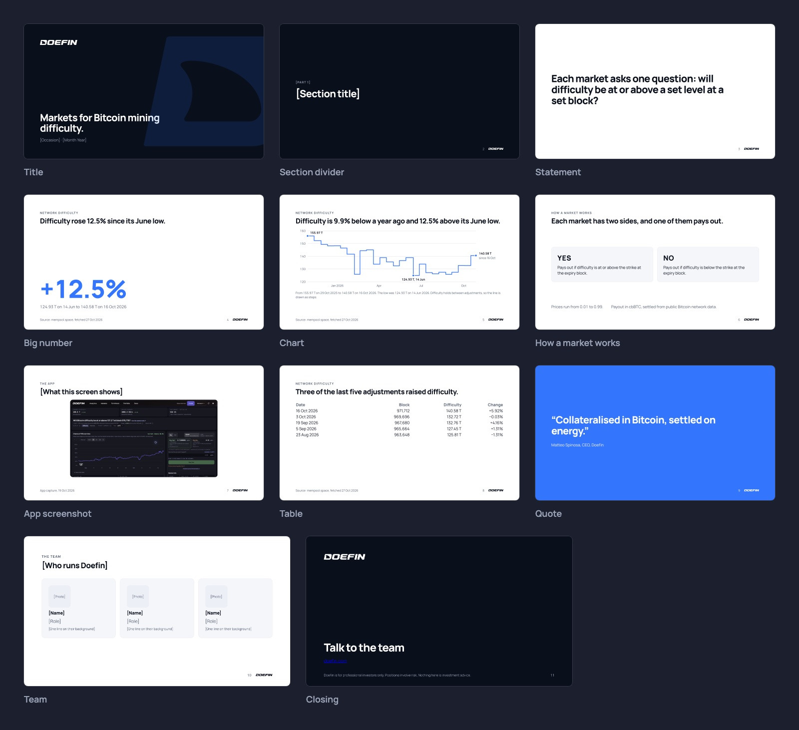

# Decks

- Start every deck from the Doefin Deck Template.
- One message per slide, written as the slide title in a full sentence: "Difficulty rose 12.5% since its June low." Never "Market overview".
- Title, section and closing slides are `ink` with the white wordmark. Content slides are white, with `text` and one `blue` highlight.
- At most one big number per slide, in `figure-xl`.
- Every slide with data has a source line at the bottom, in `small` and `text-muted`: "Source: mempool.space, fetched 27 Oct 2026."
- Four bullets at most. If you need more, write a document instead.
- The closing slide carries the disclaimer.
