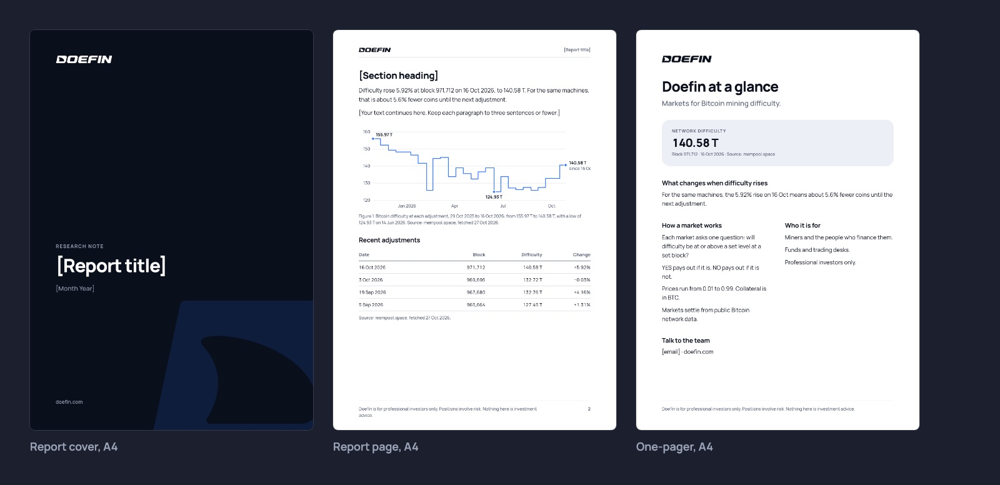

# Documents

- Reports and one-pagers start from the Documents page of Doefin Templates and export as PDF.
- A report opens with the `ink` cover: the wordmark, the title and the month. Inner pages are white, with the ink wordmark at the top.
- Each inner page ends with the disclaimer and a page number.
- Charts and tables follow the Chart rules: the numbers in a caption, the source underneath.
- Light theme, Manrope and sentence-case headings throughout.
