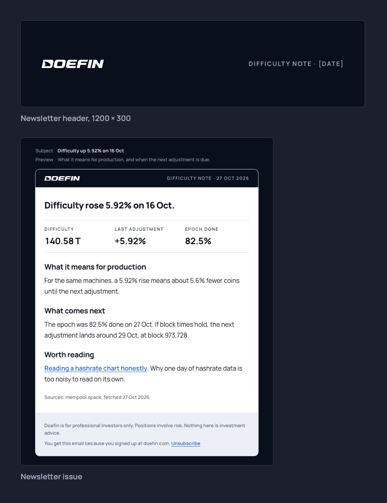

# Email and newsletter

- Subject lines carry the news in plain words, in under 50 characters and in sentence case: "Difficulty up 5.92% on 16 Oct".
- The newsletter opens with the header and one number. Three short items follow, each with its source. It closes with the disclaimer and an unsubscribe link.
- Outreach follows Matteo's pattern. The first line says why you are writing. Two or three sentences give the context. Then ask for one thing. Sign with a first name.
- Requests to the team follow his longer pattern. The goal comes first in one sentence. Then sections with capital labels (HOW IT WORKS, TIMING, PLEASE CONFIRM), ending with the questions you need answered.
- Never write "I hope this finds you well", "Just following up", "I wanted to reach out", "Quick question" or "circle back".
- Only email people who have agreed to hear from us, and keep a record of when and how they agreed.
