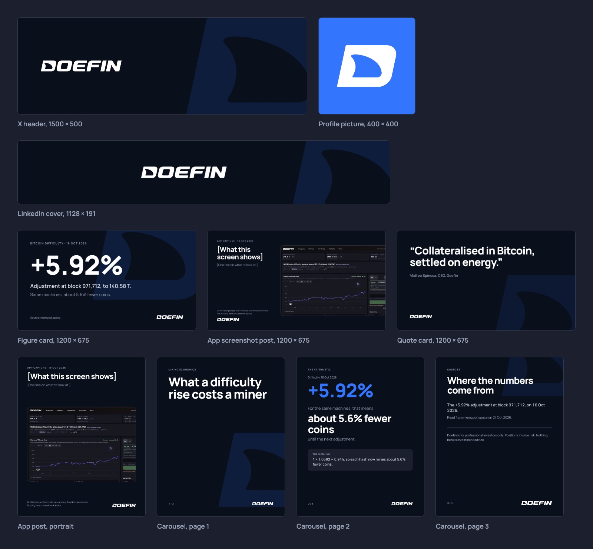

# X and LinkedIn

- Profile picture: `doefin-icon-blue.png`. Headers: `x-header-1500x500.png` and `linkedin-cover-1128x191.png`, in `assets/social/`.
- Bio: "Trade and hedge Bitcoin hashrate exposure through markets on mining difficulty. For professional investors."
- LinkedIn About: "Doefin provides markets for trading and hedging Bitcoin hashrate exposure." Then, if there is room: "Our contracts reference future Bitcoin mining difficulty. We help miners assess that exposure and give professional investors a way to trade their views through defined market outcomes."
- Write posts the way Matteo does. The first line is the number, a claim or the reader's question. Then the figures and what they mean, with their qualifiers. The last line is the view or the limit.
- On X, one sentence per line. On LinkedIn, short paragraphs of one to three sentences: up to 250 words for an argument, about 100 for an update.
- When a post needs a chart or more than a few paragraphs, write it as an article on the website. Then post the main number with the link.
- A post with a number uses the figure card: one number, its label, its date and its source. 1200 × 675 fits both X and LinkedIn.
- A post from the app uses the app screenshot template: the screen, a one-line headline and the capture date and time, with the market and quote units visible. Crop to the part that makes the point. Never show a gain or a return, or suggest a quote guarantees execution.
- A LinkedIn carousel has three to five portrait pages: the question, the arithmetic, then the source and the disclaimer.
- Posts about Doefin markets or positions end with the disclaimer (house rule; which posts need it is open in `../decisions.md`). A post only about network data does not.
- The company account says "we". Matteo says "I".
- Emoji and exclamation marks only when they fit. No hashtags, no tagging people for reach.
- Name peers only in factual comparisons backed by current evidence.
