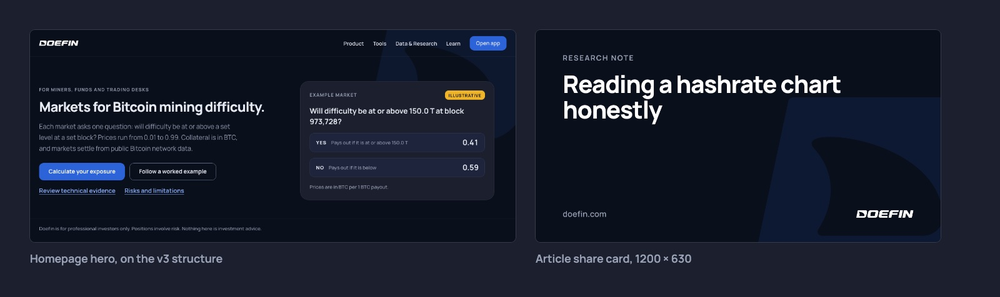

# Website and app

The site has four sections (Product, Tools, Data & Research, Learn) and an Open app button.

- Headings say what the reader gets, in under eight words: "What changes when difficulty rises?" "Find the step you need."
- Buttons start with a verb and say what happens: "Open app", "Calculate your exposure", "Talk to the team". Never "Learn more", "Click here" or "Submit".
- Data pages put the number first, with its unit, its date and a source badge: Measured, Single source, Judgement or Illustrative. Each grade is defined in `visual.md` under Badges.
- Any made-up or sample figure carries the Illustrative badge.
- Every chart has its numbers in the caption underneath.
- Error messages say what went wrong and what to do next: "Order not placed. This market closed at block 971,712. Choose an open market."
- Every page ends with the disclaimer: Doefin is for professional investors only. Positions involve risk. Nothing here is investment advice.
- Every article gets a share card at 1200 × 630: a label, the title and the wordmark. It is the picture people see when the link is shared on LinkedIn, X or Slack.
- Dark theme, `bg` ground, one `action` button per view.
